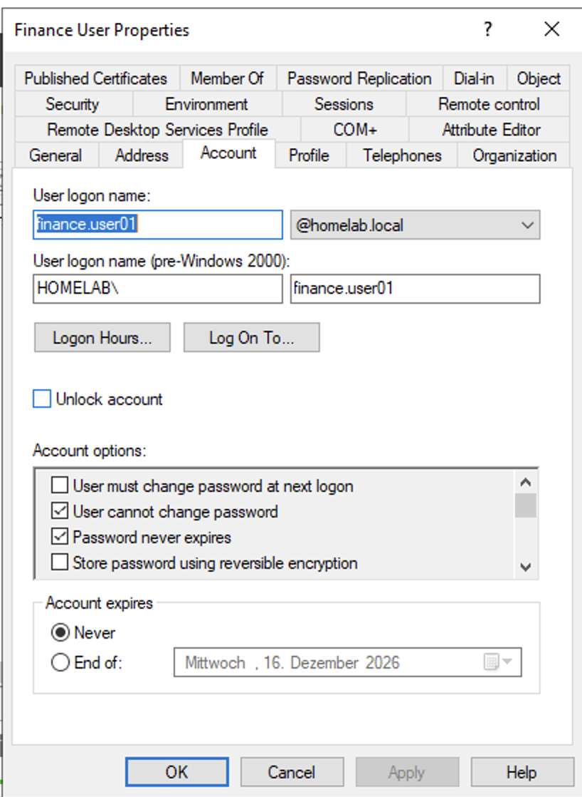
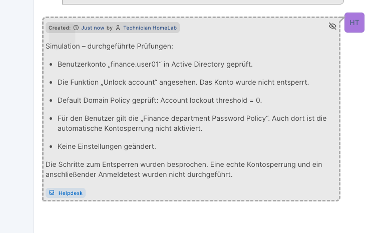
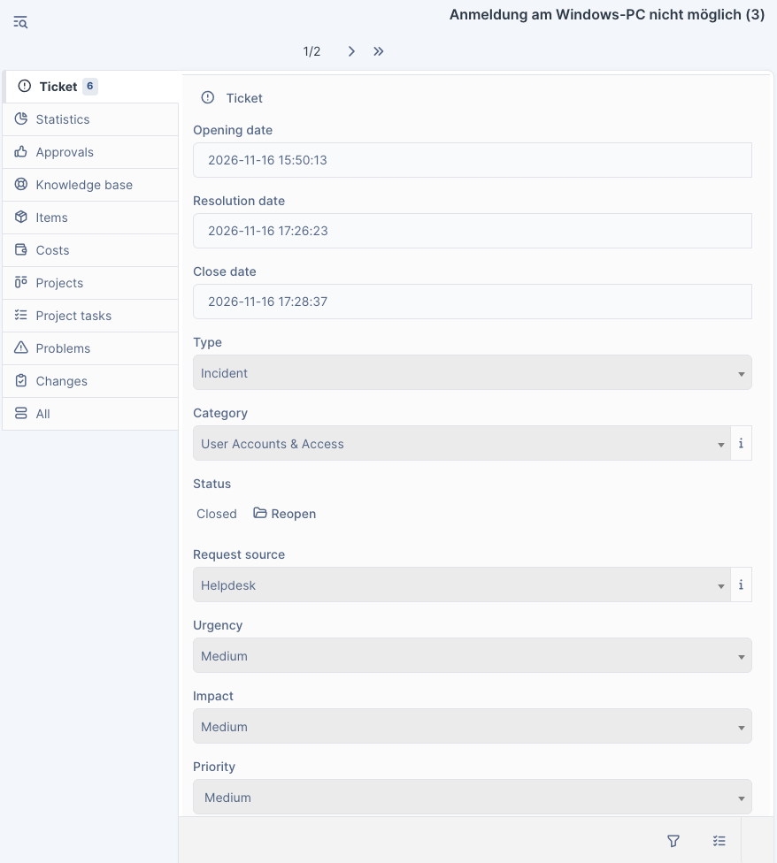
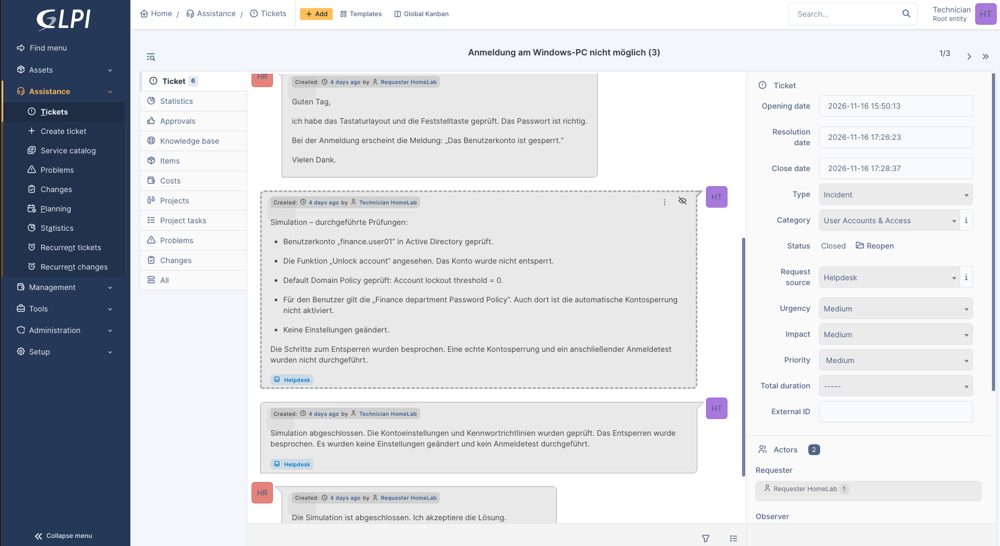

# Fall 001 – Anmeldung am Windows-PC nicht möglich

| Punkt | Details |
|---|---|
| GLPI-Ticket | #3 |
| Typ | Störung / Incident |
| Kategorie | User Accounts & Access |
| Priorität | Mittel |
| Status | Geschlossen |
| Umgebung | Windows-Domäne im HomeLab, Active Directory, GLPI |

## Hintergrund

Für meinen ersten Supportfall habe ich eine Anmeldestörung im HomeLab als Simulation bearbeitet. Ich habe das Ticket als Benutzer erstellt und danach als Techniker übernommen. Eine echte Kontosperrung, eine Entsperrung und einen Anmeldetest habe ich dabei nicht durchgeführt.

## 1. Die Meldung

Im Ticket stand, dass die Anmeldung mit dem Firmenkonto nicht mehr funktionierte. Am Vortag war die Anmeldung noch möglich.

Ich habe nach der genauen Fehlermeldung gefragt und um einen Screenshot ohne persönliche Daten gebeten. In der Benutzerrolle habe ich geantwortet, dass Tastaturlayout und Feststelltaste geprüft wurden. Die Meldung im Szenario lautete: „Das Benutzerkonto ist gesperrt.“

## 2. Das Benutzerkonto

In **Active Directory Users and Computers** habe ich das Testkonto `finance.user01` geöffnet. Unter **Properties → Account** habe ich die Kontoeinstellungen und die Funktion **Unlock account** angesehen.

## 3. Die Kennwortrichtlinien

Zuerst habe ich in **Group Policy Management** die **Default Domain Policy** geprüft. Unter **Account Lockout Policy** stand der Wert **Account lockout threshold** auf **0**. Die automatische Kontosperrung war dort also nicht aktiviert.

Danach wollte ich wissen, ob für den Benutzer eine andere Richtlinie galt. Im **Active Directory Administrative Center** habe ich **View resultant password settings** gewählt.

Dabei wurde die **Finance department Password Policy** angezeigt. Auch dort war **Enforce account lockout policy** nicht aktiviert. Die grau angezeigten Zeitwerte waren deshalb nicht aktiv.

## 4. Meine Notiz im Ticket

Die geprüften Richtlinien passten nicht zur angenommenen Kontosperrung im Szenario. Ich habe die Ergebnisse als private Notiz in GLPI festgehalten und keine Einstellungen geändert.

## 5. Der Abschluss

Ich habe das Ergebnis als Lösung eingetragen. Danach bin ich zum Benutzerkonto in GLPI gewechselt und habe die Lösung akzeptiert. Das Ticket wurde geschlossen.

Zum Abschluss habe ich auch den Nachrichtenverlauf festgehalten. Er zeigt die Antwort des Benutzers, meine technische Notiz und den Abschluss der Simulation.

## Was ich gelernt habe

Die genaue Fehlermeldung hat mir geholfen, die ersten Prüfungen auszuwählen. Bei den Richtlinien habe ich gesehen, dass für den Benutzer eine besondere Kennwortrichtlinie galt. Deshalb war die Default Domain Policy allein für diese Prüfung nicht genug.

Außerdem habe ich den Ablauf mit zwei GLPI-Konten geübt: Rückfrage, Benutzerantwort, private Notiz, Lösung und Annahme der Lösung. Die Notizen habe ich kurz gehalten und nur die tatsächlichen Prüfungen dokumentiert.

---

🏠 [Zurück zu IT Support & Troubleshooting](../README.md)
